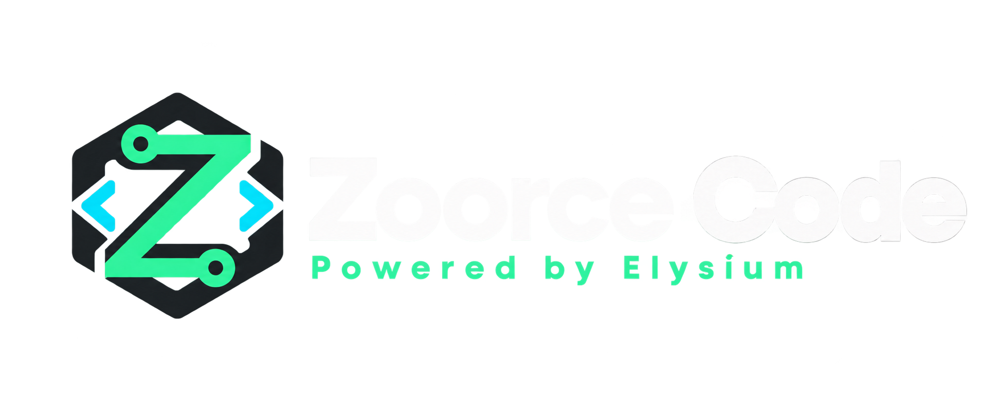

# Zoorce Code

[](https://github.com/mape1402/zoorce/actions/workflows/build-and-release.yml)
[](https://www.nuget.org/packages/Zoorce.Web.UI)
[](https://www.nuget.org/packages/Zoorce.Web.UI)
[](docs/testing.md)
[](LICENSE)

<p align="center">
  
</p>

Zoorce is an ecosystem of reusable libraries and tools developed by Elysium Coding. This repository provides `Zoorce.Web.UI`, its modular, server-rendered and progressively enhanced UI library for ASP.NET Core Razor Pages. Every component owns its markup, lifecycle and optional data binding; the host keeps ownership of domain state, navigation and transport.

## Highlights

- Typed, isolated components for layout, navigation, forms, feedback, data and workflow surfaces.
- Complete light and dark semantic palettes, customizable at runtime without a full-page rerender.
- Accessible interaction contracts: keyboard navigation, focus management, live feedback and ARIA labels.
- Host-controlled templates and transitions where content or validation belongs to the application.
- A runnable sample that exercises components as an integrated product UI.

## Packages

| Package | Use it for |
| --- | --- |
| `Zoorce.Web.UI` | The aggregate package: the complete component catalog. |
| `Zoorce.Web.UI.Abstractions` | Cross-package contracts for data, invalidation, navigation and user context. |
| `Zoorce.Web.UI.Foundation` | Buttons, feedback, dialogs, drawers, notifications, progress and skeletons. |
| `Zoorce.Web.UI.Layout` | Application shell, sidebar, top bar, command palette and resizable layout regions. |
| `Zoorce.Web.UI.Navigation` | Breadcrumbs, pagination, menus, tabs, trees, steppers and wizards. |
| `Zoorce.Web.UI.Forms` | Typed input controls, date/time pickers and selection patterns. |
| `Zoorce.Web.UI.DataGrid`, `.Charts`, `.Timelines`, `.Diagrams` | Independent data-rich visual components. |
| `Zoorce.Web.UI.Theming` | Theme palettes, semantic tokens and color modes. |
| `Zoorce.Web.UI.Realtime.SignalR` | Optional SignalR-to-invalidation adapter. |

## Getting started

### 1. Install the aggregate package

```bash
dotnet add package Zoorce.Web.UI
```

### 2. Register Zoorce in `Program.cs`

```csharp
using Zoorce.Web.UI;
using Zoorce.Web.UI.Theming;

var builder = WebApplication.CreateBuilder(args);

builder.Services
    .AddRazorPages()
    .AddZoorceWebUI(shell =>
    {
        shell.ApplicationName = "My product";
        shell.Themes.UsePreset(ZoorceThemePreset.Amethyst);
        shell.Themes.Light.Primary = "#087a57";
        shell.Themes.Dark.Primary = "#20e7a0";
    });

var app = builder.Build();

app.MapStaticAssets();
app.MapRazorPages().WithStaticAssets();
app.Run();
```

### 3. Enable the shell and tag helpers

In `Pages/_ViewStart.cshtml`, select the included layout:

```cshtml
@{ Layout = "_ZoorceLayout"; }
```

Add the tag helpers in `Pages/_ViewImports.cshtml`:

```cshtml
@addTagHelper *, Microsoft.AspNetCore.Mvc.TagHelpers
@addTagHelper *, Zoorce.Web.UI
```

The default shell has no application navigation until the host supplies a navigation provider. The layout loads the library styles and scripts; standalone pages can use `_ZoorceStandaloneLayout` instead.

### 4. Render a component

```cshtml
@using Zoorce.Web.UI.Foundation.Components

@await Component.InvokeAsync("ZoorceProgressButton", new ZoorceProgressButtonOptions
{
    Id = "publish-release",
    Text = "Publish release",
    Progress = 0,
    Tone = "primary"
})
```

Use the component option type to own labels, variants, templates, state and behavior. For visual changes, set the semantic palette tokens once on the shell or scope CSS variables to an individual component root.

### Optional top-bar back action

The back action is hidden by default. To show it on one Razor Page, configure it before the layout renders:

```cshtml
@using Zoorce.Web.UI.Layout.Components
@{
    ViewData["ZoorceTopBarBack"] = new ZoorceTopBarBackOptions
    {
        Visible = true,
        Label = "Back to projects",
        Url = "~/projects"
    };
}
```

Set `shell.TopBarBack` during registration to supply a default for all pages. A page can override that default, including hiding it with `Visible = false`. With `Url`, the control is a normal link. Without `Url`, it is a button and the host can attach a click handler to `[data-z-topbar-back]`; Zoorce does not assume browser history or provide navigation behavior. The Navigation sample demonstrates a page-specific link.

For a custom action, omit `Url` and register the handler in the page's `Scripts` section:

```cshtml
@section Scripts {
    <script>
        document.querySelector('button[data-z-topbar-back]')?.addEventListener('click', () => {
            // Perform the host application's action here.
        });
    </script>
}
```

For example, customize the progress button's active and completed colors:

```css
#publish-release {
  --z-progress-active: #0e7490;
  --z-progress-complete: #059669;
}
```

### Standalone sign-in page

The sign-in entry point is a presentation component, not an authentication provider. Create a Razor Page and opt out of your application shell by selecting `_ZoorceStandaloneLayout`. Configure the button to target your application's authentication challenge endpoint; configure and secure that endpoint in the host application. If the application uses a fallback authorization policy, allow anonymous access to the sign-in page and its challenge endpoint as appropriate, and validate any return URL in the host.

```cshtml
@page "/sign-in"
@using Zoorce.Web.UI.Layout.Components
@{
    Layout = "_ZoorceStandaloneLayout";
    ViewData["Title"] = "Sign in";
}
@await Component.InvokeAsync("ZoorceSignIn", new ZoorceSignInOptions
{
    ApplicationName = "Your application",
    SignInUrl = "/account/challenge",
    Title = "Welcome back.",
    Description = "Sign in to continue."
})
```

Brand mark or logo, optional wordmark image (`WordmarkUrl`), brand subtitle and hero highlights, illustration, headings, descriptions, button label, hint and footer links are configurable through `ZoorceSignInOptions`. A host can set `WordmarkClass` for custom wordmark styling and disable the diagonal light trails with `ShowShootingStars`. Their color can be overridden with `--z-signin-spark-color`. The default animated vector illustration follows the theme's primary color, and animations respect reduced-motion preferences. You can supply an `IllustrationUrl` for custom artwork, although a raster image will not automatically recolor with the theme. The standalone layout applies the configured Zoorce theme without rendering the sidebar or top bar. Use `ViewData["Language"]` to set the document language. The host can optionally set `SignInEnabled` to `false` when it needs a disabled button.

The sample's sign-in button opens the sample home page by default. Set `Sample:SignInUrl` to a host-owned authentication challenge URL to use another destination. Zoorce does not authenticate users or configure an identity provider; the host application owns that integration and its security.

### Standalone status pages

`ZoorceStatusPage` provides themed, animated presentations for 401, 403, 404, 500 and 503. The component renders presentation only: the host chooses when to show it, handles exceptions and authentication, and sets or preserves the actual HTTP response status. For example, in a Razor Page:

```cshtml
@page "/status/404"
@using Zoorce.Web.UI.Layout.Components
@{
    Layout = "_ZoorceStandaloneLayout";
    Response.StatusCode = 404;
    ViewData["Title"] = "Page not found";
    var status = ZoorceStatusPageOptions.ForStatus(404, homeUrl: Url.Content("~/"));
}
@await Component.InvokeAsync("ZoorceStatusPage", status)
```

Use `ForStatus(code, homeUrl, signInUrl, retryUrl)` to configure host-owned destinations; for retry actions, pass the intended safe retry URL. Customize the status code, title, description, speech, brand, CSS class and action list. The optional `Details` and `DetailsLabel` display host-approved diagnostic text; details are never populated automatically. Provide trusted `IHtmlContent` via `IllustrationContent` and `AdditionalContent`. Set `ShowIllustration` or `ShowShootingStars` to false, set `Speech` to null to hide its bubble, or use an empty action list. CSS variables including `--z-status-accent`, `--z-status-foreground`, `--z-status-suit`, `--z-status-visor`, `--z-status-spark-color` and `--z-status-texture-opacity` control appearance. The component respects reduced-motion preferences. If using a different layout, include `~/_content/Zoorce.Web.UI.Layout/css/zoorce-status-page.css` yourself.

Configure the host's exception handler and status-code handling or routing to render the desired page. Avoid exposing exception details, validate any user-provided return URL, and explicitly preserve the desired HTTP status. The sample links to `/status/401`, `/status/403`, `/status/404`, `/status/500` and `/status/503`; those demonstration routes return the indicated status code and are not an authentication implementation.

### Valky help companion

Register the tag helpers with `@addTagHelper *, Zoorce.Web.UI` in `_ViewImports.cshtml`, then place Valky wherever help is needed:

```cshtml
<zoorce-valky id="help-companion" state="thinking" open="true" floating="true"
              label="Valky, open or close help" style="--z-valky-size: 180px">
    <strong>Need a hand?</strong>
    <p>Replace this content with your application's help.</p>
</zoorce-valky>
```

The initial `state` is `idle`, `thinking`, `talking`, or `celebrating`. A host can change it at runtime with `element.dataset.zValkyState = 'thinking'`. The native details control owns bubble open/close, including keyboard interaction; its `open` property can also be changed by the host. Bubble content is a Razor template; alternatively use `message` for encoded plain text. `floating` is optional.

Celebration runs once by default, returns to `idle`, and emits a bubbling `zoorce:valky-state-change` event with `detail.state` and `detail.reason` (`celebration-complete`). Set `celebration-loop="true"` to keep celebrating until the host changes the state; at runtime set `element.dataset.zValkyCelebration` to `loop` or `once`. Customize the duration with `--z-valky-celebration-speed` and the one-shot repetition count with `--z-valky-celebration-count`.

Customize `--z-valky-size`, `--z-valky-bubble-background`, `--z-valky-bubble-color`, `--z-valky-bubble-border`, `--z-valky-inset-inline`, `--z-valky-inset-block` and `--z-valky-z-index` per instance. The optional `image-url` and `body-image-url` override the head and headless-body artwork; replacements must match Valky's original 1230 × 1278 layout and layer alignment because the animation uses fixed clipping and facial coordinates. The component loads its own JavaScript module; ensure the library's static assets are served. Animations are disabled when reduced motion is requested, while one-shot celebration still returns to idle. See the **Valky assistant** sample for interactive states.

### Native charts

`ZoorceChart` is a native-SVG component: charts inherit the active Zoorce palette and do not require a third-party charting runtime. The existing card remains the default, while the host can remove all card chrome for dashboard composition with `ZoorceChartSurface.Bare`. Header, metric, legend interaction and tooltip feedback are independently optional.

```cshtml
@await Component.InvokeAsync("ZoorceChart", new ZoorceChartOptions
{
    Id = "activity",
    Title = "Activity",
    Summary = "Bounded activity over time",
    Kind = ZoorceChartKind.Area,
    Curve = ZoorceChartCurve.Monotone,
    MinimumValue = 0,
    Appearance = new ZoorceChartAppearanceOptions { Surface = ZoorceChartSurface.Bare },
    Header = new ZoorceChartHeaderOptions { ShowMetric = false },
    Legend = new ZoorceChartLegendOptions { Visible = false },
    Series = activitySeries
})
```

`Monotone` is opt-in and preserves the bounds between adjacent observations, including uneven X values; `Smooth` retains its existing appearance. The catalogue includes trend, area, range area, grouped/stacked bars, combo/secondary-axis, donut or pie (`DonutInnerRadius = 0`), radial, gauge, funnel, heatmap/calendar heatmap, scatter/bubble, bullet, histogram, waterfall, lollipop, slope, radar, candlestick, box plot, treemap, Sankey and Gantt charts. Specialized visuals accept their explicit data contracts (`OhlcPoints`, `BoxPlotPoints`, `TreemapItems`, `SankeyNodes`/`SankeyLinks`, and `GanttItems`) rather than overloading ordinary point data.

## Run the sample

```bash
dotnet run --project samples/Zoorce.Sample --urls http://127.0.0.1:5135
```

Open `http://127.0.0.1:5135` to explore the component gallery, test light/dark themes and exercise interactive controls. The standalone sign-in example is at `/sign-in`; the status-page examples are at `/status/401`, `/status/403`, `/status/404`, `/status/500` and `/status/503`.

## Quality and release

```bash
npm ci
npm run css:build
dotnet test tests/Zoorce.Web.UI.Tests/Zoorce.Web.UI.Tests.csproj --configuration Release
for project in src/*/*.csproj; do
  dotnet pack "$project" --configuration Release --output artifacts/packages
done
```

The build and release workflow builds the CSS, compiles the solution, enforces the coverage threshold and packages the libraries. A change to `.release` on `main` triggers the corresponding GitHub release and NuGet publication after those checks pass. See [RELEASE.md](RELEASE.md) for the release process and prerequisites.

See [component customization](docs/components.md), [architecture](docs/architecture.md), [testing](docs/testing.md), and [the changelog](CHANGELOG.md).

## License

Zoorce is licensed under the [MIT License](LICENSE). Copyright © 2026 Elysium Coding.
